# Домашнее задание к занятию «Ветвления в Git»

**Выполнила:** Ксения Волчица

---

## Цель задания

- Потренироваться делать `merge` и `rebase`.
- Понять разницу между ними.
- Научиться решать конфликты.

---

## Задание «Ветвление, merge и rebase»

### Шаг 1. Создание каталога и файлов

Создан каталог `branching` с двумя файлами: `merge.sh` и `rebase.sh`.

**Содержимое обоих файлов:**

```bash
#!/bin/bash
# display command line options

count=1
for param in "$*"; do
    echo "\$* Parameter #$count = $param"
    count=$(( $count + 1 ))
done
```

Скрипт отображает все параметры одной строкой.

**Скриншот:**

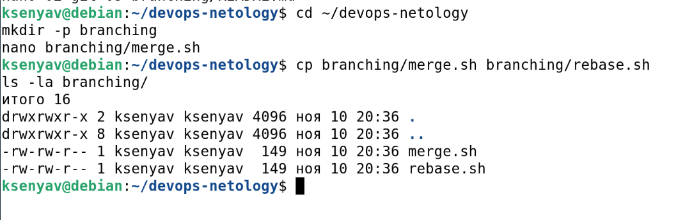

---

### Шаг 2. Первый коммит в main

```bash
git add branching/
git commit -m 'prepare for merge and rebase'
git push origin main
```

**Скриншот:**

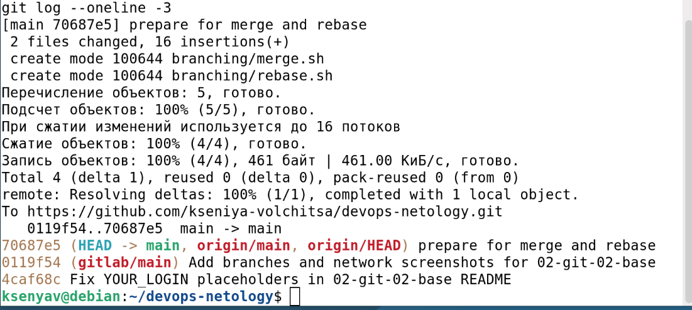

---

## Подготовка файла merge.sh

### Шаг 1. Создание ветки git-merge

```bash
git switch -c git-merge
```

### Шаг 2. Изменение merge.sh

Файл `branching/merge.sh` изменён на:

```bash
#!/bin/bash
# display command line options

count=1
for param in "$@"; do
    echo "\$@ Parameter #$count = $param"
    count=$(( $count + 1 ))
done
```

### Шаг 3. Коммит `merge: @ instead *`

```bash
git add branching/merge.sh
git commit -m 'merge: @ instead *'
git push -u origin git-merge
```

### Шаг 4. Второе изменение merge.sh

Файл `branching/merge.sh` изменён на:

```bash
#!/bin/bash
# display command line options

count=1
while [[ -n "$1" ]]; do
    echo "Parameter #$count = $1"
    count=$(( $count + 1 ))
    shift
done
```

### Шаг 5. Коммит `merge: use shift`

```bash
git add branching/merge.sh
git commit -m 'merge: use shift'
git push origin git-merge
```

**Скриншот:**

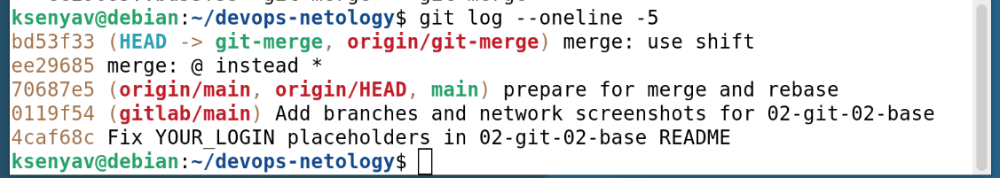

---

## Изменение main

### Шаг 1. Возврат в main

```bash
git switch main
```

### Шаг 2. Изменение rebase.sh

Файл `branching/rebase.sh` изменён на:

```bash
#!/bin/bash
# display command line options

count=1
for param in "$@"; do
    echo "\$@ Parameter #$count = $param"
    count=$(( $count + 1 ))
done

echo "====="
```

### Шаг 3. Пуш main

```bash
git add branching/rebase.sh
git commit -m 'rebase: @ instead *'
git push origin main
```

**Скриншот:**

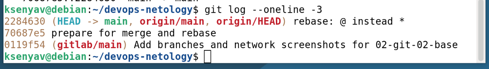

---

## Подготовка файла rebase.sh

### Шаг 1. Поиск коммита `prepare for merge and rebase`

```bash
git log --oneline
```

### Шаг 2. Переход на этот коммит

```bash
git checkout <hash>
```

### Шаг 3. Создание ветки git-rebase

```bash
git switch -c git-rebase
```

### Шаг 4. Изменение rebase.sh

Файл `branching/rebase.sh` изменён на:

```bash
#!/bin/bash
# display command line options

count=1
for param in "$@"; do
    echo "Parameter: $param"
    count=$(( $count + 1 ))
done

echo "====="
```

### Шаг 5. Коммит `git-rebase 1`

```bash
git add branching/rebase.sh
git commit -m 'git-rebase 1'
git push -u origin git-rebase
```

### Шаг 6. Коммит `git-rebase 2`

Заменено `echo "Parameter: $param"` на `echo "Next parameter: $param"`.

```bash
git add branching/rebase.sh
git commit -m 'git-rebase 2'
git push origin git-rebase
```

**Скриншот:**

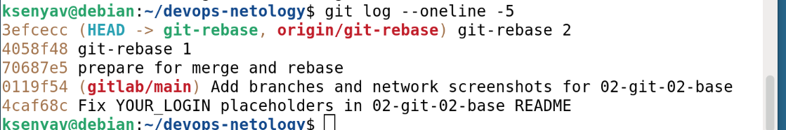

---

## Промежуточный итог

На странице network видна схема:

- Ветка `git-merge` — 2 коммита от `prepare for merge and rebase`.
- Ветка `git-rebase` — 2 коммита от `prepare for merge and rebase`.
- Ветка `main` — 1 коммит от `prepare for merge and rebase`.

**Скриншот:**

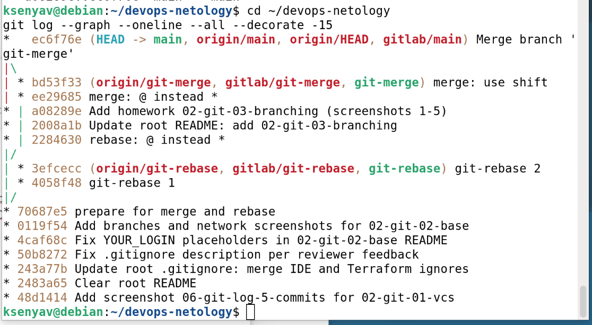

---

## Merge

Сливаем ветку `git-merge` в main:

```bash
git switch main
git merge git-merge
git push origin main
```

**Ожидаемый результат:** merge без конфликтов (recursive strategy).

**Скриншот:**

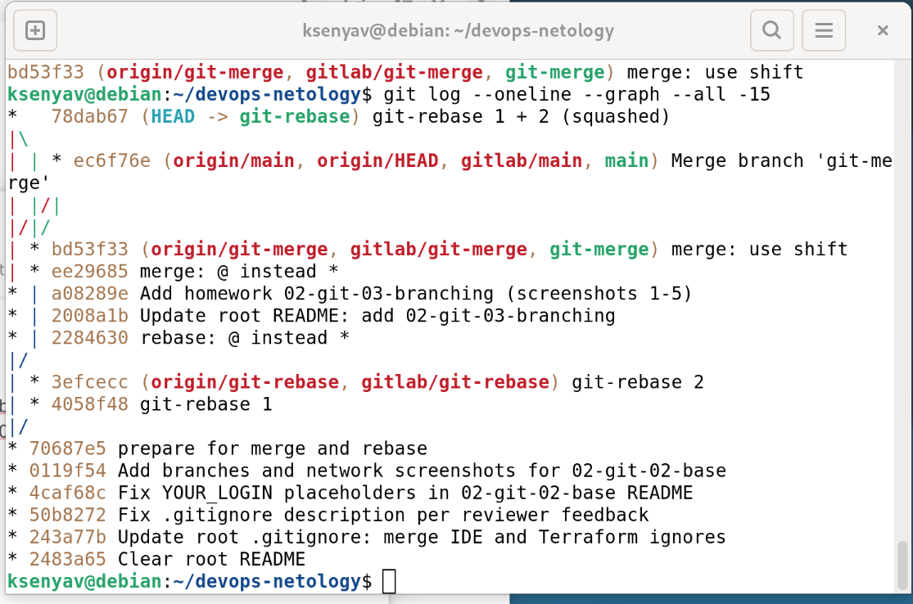

**Network graph после merge:**

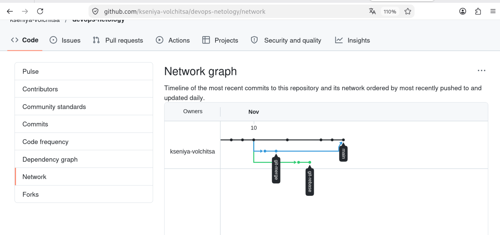

---

## Rebase

### Шаг 1. Переключение на git-rebase

```bash
git switch git-rebase
```

### Шаг 2. Rebase на main с объединением коммитов

```bash
git rebase -i main
```

В диалоге:
- Первый коммит — `pick`.
- Второй коммит — заменить `pick` на `fixup`.

**Получен конфликт в `branching/rebase.sh`:**

```
Auto-merging branching/rebase.sh
CONFLICT (content): Merge conflict in branching/rebase.sh
```

**Содержимое rebase.sh с метками конфликта:**

```bash
#!/bin/bash
# display command line options
count=1
for param in "$@"; do
<<<<<<< HEAD
    echo "\$@ Parameter #$count = $param"
=======
    echo "Parameter: $param"
>>>>>>> dc4688f... git 2.3 rebase @ instead *
    count=$(( $count + 1 ))
done
```

### Шаг 3. Разрешение первого конфликта

Оставлен вариант:

```bash
    echo "\$@ Parameter #$count = $param"
```

Удалены метки `<<<<<<<`, `=======`, `>>>>>>>`.

```bash
git add branching/rebase.sh
git rebase --continue
```

### Шаг 4. Второй конфликт

При применении второго коммита снова конфликт. Оставлена строка:

```bash
    echo "Next parameter: $param"
```

```bash
git add branching/rebase.sh
git rebase --continue
```

### Шаг 5. Комментарий к объединённому коммиту

Открылся редактор. Сохранён предложенный комментарий:

```
Merge branch 'git-merge'
```

### Шаг 6. Результат

```
Successfully rebased and updated refs/heads/git-rebase
```

### Шаг 7. Push с флагом `--force`

```bash
git push -u origin git-rebase -f
```

**Ожидаемый результат:**

```
+ 1829df1...e3b942b git-rebase -> git-rebase (forced update)
```

**Скриншот:**

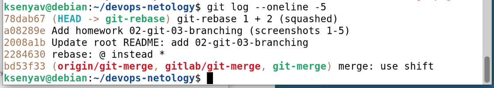

**Network graph после rebase:**

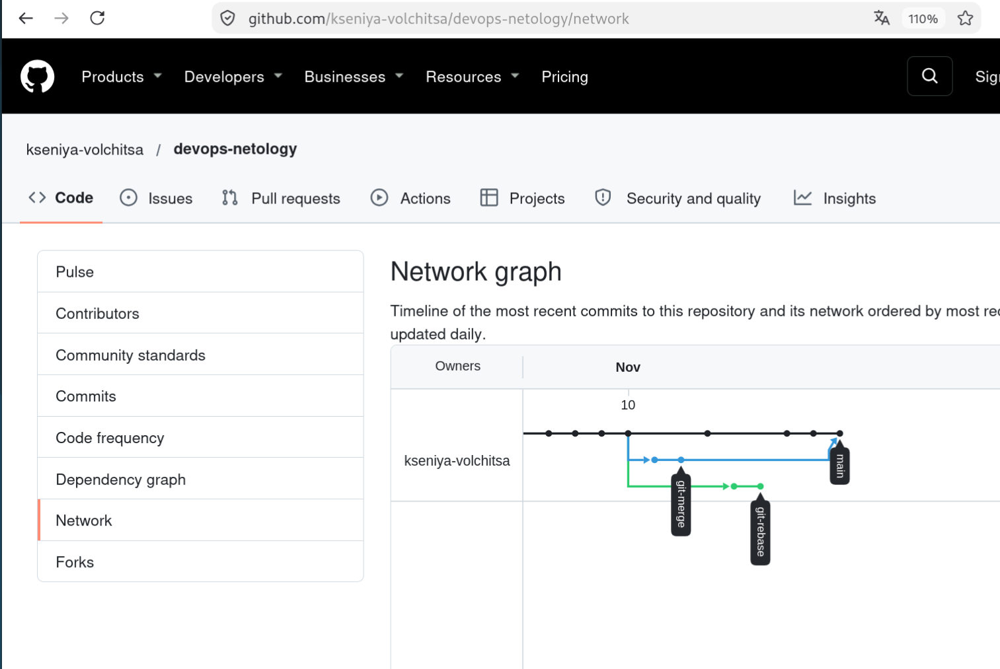

---

### Шаг 8. Merge git-rebase в main

```bash
git switch main
git merge git-rebase
git push origin main
```

**Ожидаемый результат:** Fast-forward без конфликтов.

```
Updating 6158b76..45893d1
Fast-forward
```

**Результат:** merge-коммит `Merge branch 'git-rebase'`.


**Скриншот:**

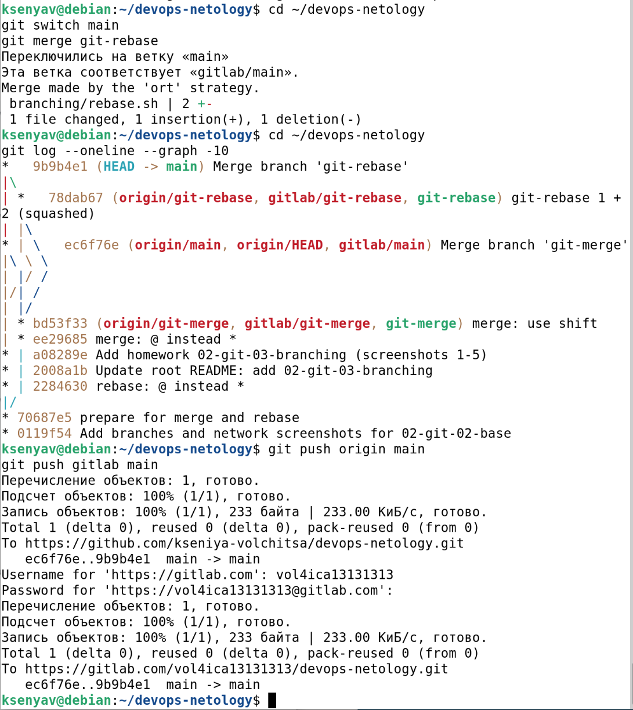

---

## Итоговая схема

**Финальный network graph:**

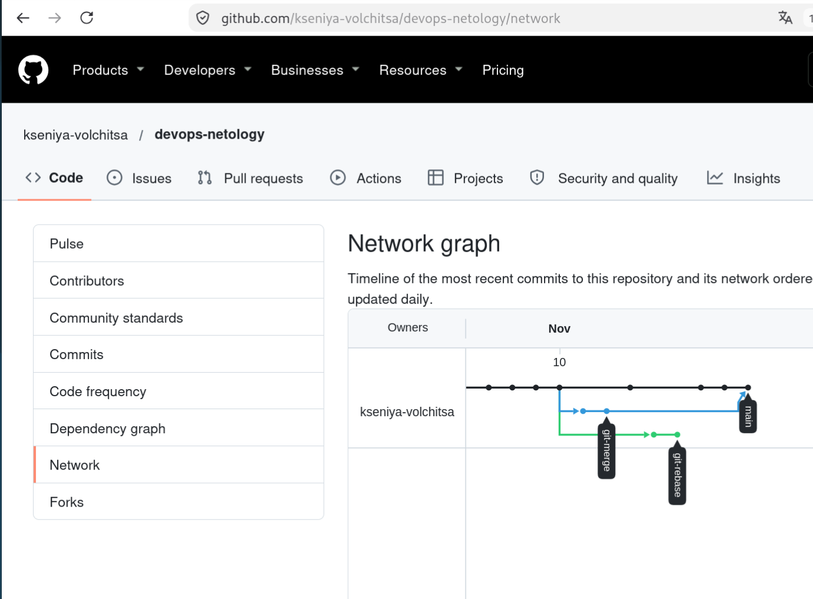

**Ссылка на network:**

https://github.com/kseniya-volchitsa/devops-netology/network

---

## Итог

В результате выполнения задания:

- ✅ Освоены `git merge` и `git rebase`.
- ✅ Разрешены конфликты при rebase.
- ✅ Объединены коммиты через `git rebase -i` с `fixup`.
- ✅ Освоен `git push --force`.
- ✅ Выполнен fast-forward merge.

---

## Ссылки на репозитории

- **GitHub:** https://github.com/kseniya-volchitsa/devops-netology
- **GitLab:** https://gitlab.com/vol4ica13131313/devops-netology
