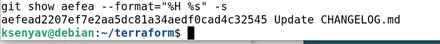
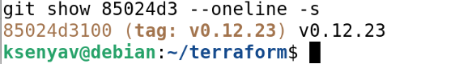
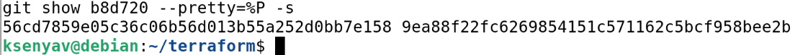
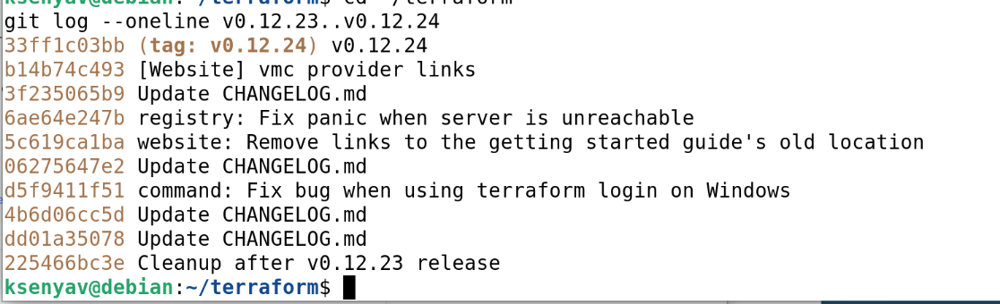
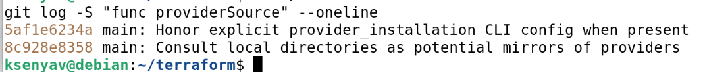
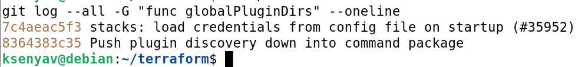
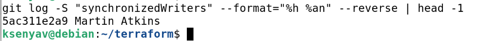

# Домашнее задание к занятию «Инструменты Git»

**Выполнила:** Ксения Волчица

---

## Задание

В клонированном репозитории `hashicorp/terraform` необходимо найти информацию о коммитах и функциях, используя утилиты Git.

### Подготовка

```bash
git clone https://github.com/hashicorp/terraform.git
cd terraform
```

---

## 1. Полный хеш и комментарий коммита `aefea`

**Команда:**

```bash
git rev-parse aefea
git show aefea --format="%H %s" -s
```

**Ответ:**

- **Полный хеш:** `aefead2207ef7e2aa5dc81a34aedf0cad4c32545`
- **Комментарий:** `Update CHANGELOG.md`

**Скриншот:**



---

## 2. Тег для коммита `85024d3`

**Команда:**

```bash
git show 85024d3 --oneline -s
```

**Ответ:** тег **`v0.12.23`**

**Скриншот:**



---

## 3. Родители коммита `b8d720`

**Команда:**

```bash
git show b8d720 --pretty=%P -s
```

**Ответ:**

- **Количество родителей:** 2 (merge-коммит)
- **Хеши родителей:**
  - `56cd7859e05c36c06b56d013b55a252d0bb7e158`
  - `9ea88f22fc6269854151c571162c5bcf958bee2b`

**Скриншот:**



---

## 4. Коммиты между тегами `v0.12.23` и `v0.12.24`

**Команда:**

```bash
git log --oneline v0.12.23..v0.12.24
```

**Ответ:**

| Хеш | Комментарий |
|-----|-------------|
| `33ff1c03bb` | `v0.12.24` |
| `b14b74c493` | `[Website] vmc provider links` |
| `3f235065b9` | `Update CHANGELOG.md` |
| `6ae64e247b` | `registry: Fix panic when server is unreachable` |
| `5c619ca1ba` | `website: Remove links to the getting started guide's old location` |
| `06275647e2` | `Update CHANGELOG.md` |
| `d5f9411f51` | `command: Fix bug when using terraform login on Windows` |
| `4b6d06cc5d` | `Update CHANGELOG.md` |
| `dd01a35078` | `Update CHANGELOG.md` |
| `225466bc3e` | `Cleanup after v0.12.23 release` |

**Скриншот:**



---

## 5. Коммит создания `func providerSource`

**Команда:**

```bash
git log -S "func providerSource" --oneline
```

**Ответ:** коммит **`8c928e8358`** — `main: Consult local directories as potential mirrors of providers`

**Проверка:**

```bash
git show 8c928e8358:provider_source.go | grep "func providerSource"
```

**Результат:**

```
func providerSource(services *disco.Disco) getproviders.Source {
```

**Скриншот:**



---

## 6. Коммиты изменения `globalPluginDirs`

**Команда:**

```bash
git log --all -G "func globalPluginDirs" --oneline
```

**Ответ:** функция `globalPluginDirs` изменялась в коммитах:

- `7c4aeac5f3` — `stacks: load credentials from config file on startup (#35952)`
- `8364383c35` — `Push plugin discovery down into command package`

**Скриншот:**



---

## 7. Автор функции `synchronizedWriters`

**Команда:**

```bash
git log -S "synchronizedWriters" --format="%h %an" --reverse | head -1
```

**Ответ:** автор — **Martin Atkins**, коммит `5ac311e2a9`

**Скриншот:**



---

## Итог

В результате выполнения задания:

- ✅ Найден полный хеш и комментарий коммита `aefea`
- ✅ Определён тег для коммита `85024d3`
- ✅ Найдены родители merge-коммита `b8d720`
- ✅ Перечислены коммиты между тегами `v0.12.23` и `v0.12.24`
- ✅ Найден коммит создания функции `providerSource`
- ✅ Найдены коммиты изменения функции `globalPluginDirs`
- ✅ Определён автор функции `synchronizedWriters`

---

## Ссылки

- **GitHub:** https://github.com/kseniya-volchitsa/devops-netology
- **GitLab:** https://gitlab.com/vol4ica13131313/devops-netology
